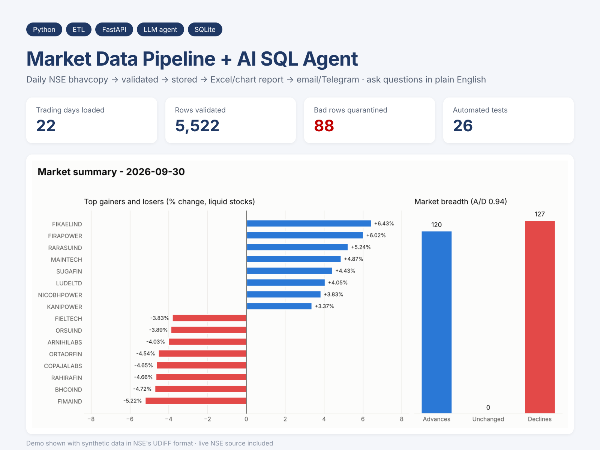
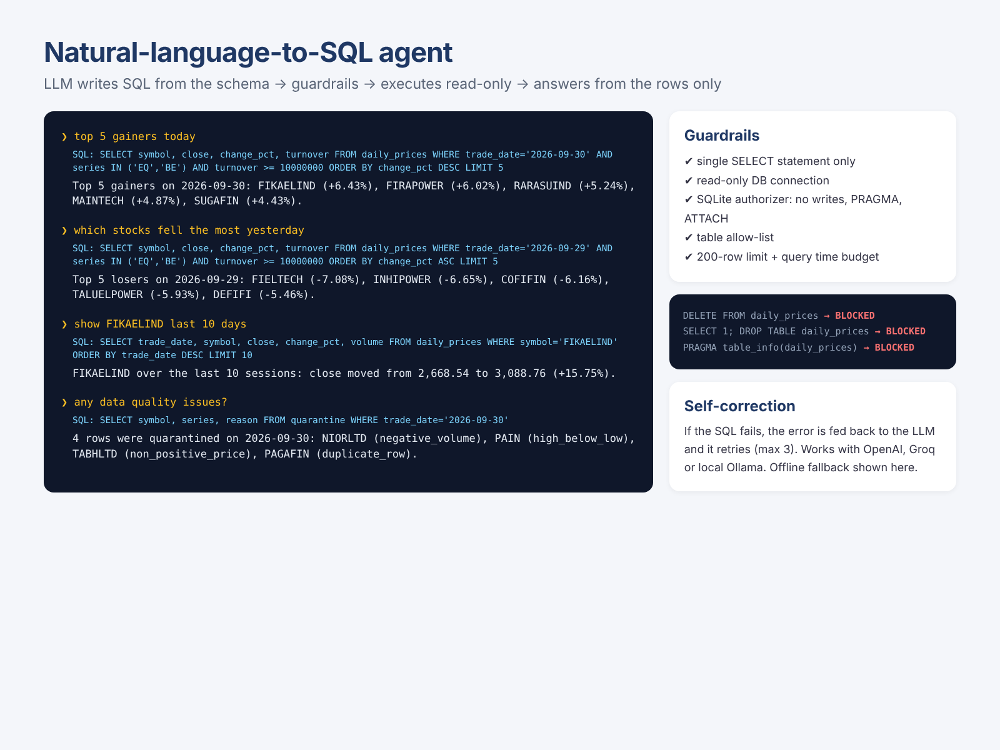

# Market Data Pipeline + AI SQL Agent

A production-style ETL pipeline for India's NSE daily equity bhavcopy: download → validate → store → report → deliver.
On top of it, a **natural-language-to-SQL agent** lets anyone ask questions like *"which liquid stocks fell more than 3% yesterday?"*,
with guardrails that make it impossible for the LLM to modify data.



## Features
- **Fetch**: official NSE UDiFF bhavcopy, with session cookies, retries with exponential backoff, corrupt-file detection and holiday skipping
- **Validate**: 6 data-quality checks (missing values, non-positive prices, high < low, close outside range, negative volume, duplicates). Bad rows go to a `quarantine` table with the reason, not into your reports
- **Store**: SQLite with idempotent loads (re-running a day never duplicates data) and a `pipeline_runs` audit log
- **Report**: market breadth, top gainers/losers (liquidity-filtered), most active, 5-day momentum → multi-sheet Excel + chart + HTML email
- **Deliver**: email (SMTP) and Telegram, each optional
- **AI agent**: LLM writes SQL from the schema → guardrails → read-only execution → answer grounded in the returned rows. Self-corrects by feeding SQL errors back to the model. Works with OpenAI, Groq or a local Ollama model; runs in offline rule-based mode without a key
- **API**: FastAPI endpoints for runs, prices, reports, the agent and guarded raw SQL
- **Quality**: 26 pytest tests (validation, idempotency, network failures, guardrails, LLM self-correction, API end to end), Docker

## Agent guardrails
| Layer | What it stops |
|---|---|
| Statement check | anything that isn't a single `SELECT` / `WITH` |
| Read-only connection (`mode=ro`) | any write, even if every other check failed |
| SQLite authorizer callback | `INSERT/UPDATE/DELETE`, DDL, `PRAGMA`, `ATTACH`, tables outside the allow-list |
| Row limit + VM step budget | huge result sets and runaway queries |
| Answer prompt | the LLM may only use the returned rows, never invent numbers |



## Run on Windows (double-click)
| File | What it does |
|---|---|
| `setup.bat` | One-time install (virtual env + requirements + `.env`) |
| `run_demo.bat` | Loads a month of sample data, asks the agent questions, opens the report |
| `ask.bat` | Chat with the AI agent |
| `start_server.bat` | Starts the API and opens Swagger docs at http://127.0.0.1:8000/docs |
| `run_today_nse.bat` | Downloads **today's real NSE file** (published ~6-7 PM IST), loads it, sends the report |
| `backfill_nse.bat` | Loads real NSE data for a date range |
| `schedule_daily.bat` | Creates a Windows scheduled task: every weekday at 7:15 PM |
| `run_tests.bat` | Runs the test suite |

## Quick start (any OS)
```bash
pip install -r requirements.txt
python run_pipeline.py --source sample --start 2026-09-01 --end 2026-09-30   # demo data
python run_pipeline.py --source nse --date 2026-09-30                        # real NSE data
python ask.py "top 5 gainers today"
uvicorn api:app --reload
pytest -q
```

## API
| Method | Path | Purpose |
|---|---|---|
| POST | `/pipeline/run` | Run the pipeline for a date or range (`sample` or `nse`) |
| GET | `/pipeline/runs` | Audit log of runs and data-quality results |
| GET | `/prices/{symbol}?days=20` | Price history for a stock |
| GET | `/report/{date}` | Report as JSON (`/excel`, `/chart` for files) |
| POST | `/ask` | Ask a question in plain English |
| POST | `/sql` | Run your own read-only SQL (same guardrails) |
| GET | `/health` | Latest date and row count |

## Configuration (`.env`)
`LLM_API_KEY`, `LLM_MODEL`, `LLM_BASE_URL` (blank for OpenAI, `https://api.groq.com/openai/v1` for Groq, `http://localhost:11434/v1` for Ollama),
`SMTP_*` / `MAIL_TO` for email, `TELEGRAM_BOT_TOKEN` / `TELEGRAM_CHAT_ID` for Telegram, `MIN_TURNOVER_FOR_RANKING` for the liquidity filter.

## Design notes
- **Same format for demo and production.** The sample source writes synthetic data in NSE's exact UDiFF zip format, so tests exercise the real parser, not a shortcut.
- **Quarantine instead of crash.** Exchange files occasionally contain bad rows; the pipeline loads the good rows, keeps the bad ones with a reason, and records counts in the run log.
- **Defence in depth for LLM SQL.** Prompting the model to "only write SELECT" is not a security control. The read-only connection and authorizer are.

## Project structure
```
market_pipeline/
  sources.py    NSE downloader + synthetic UDiFF generator
  transform.py  parsing + data-quality checks
  storage.py    SQLite schema, upserts, run log, read-only connection
  report.py     analytics, Excel, chart, email HTML
  notify.py     email + Telegram
  agent.py      NL-to-SQL agent + guardrails
  pipeline.py   orchestration
run_pipeline.py CLI         ask.py  agent CLI         api.py  FastAPI
tests/          26 tests
```

*Demo data is synthetic. Real NSE data is downloaded at runtime and is not stored in this repository.*
